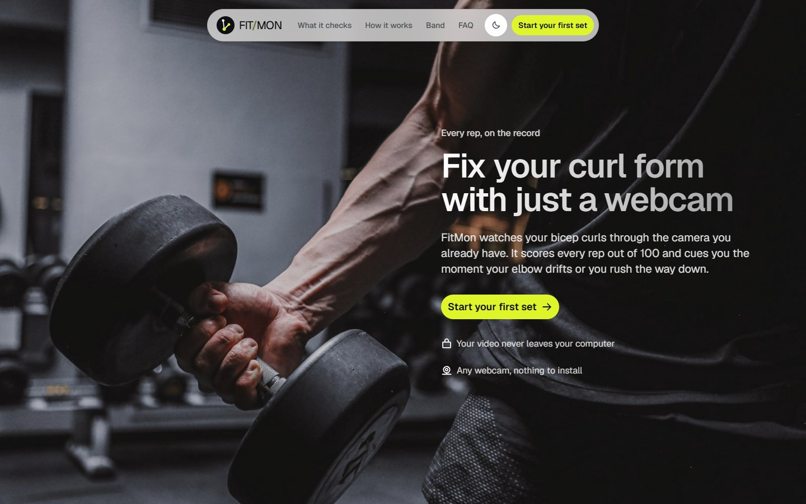
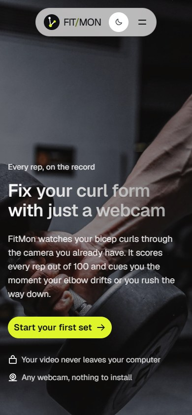
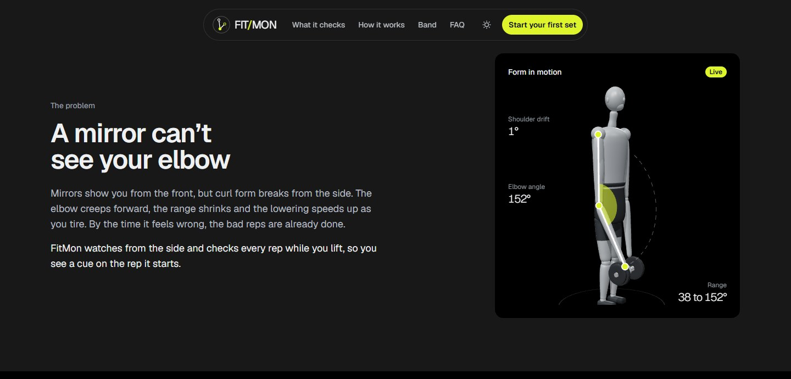
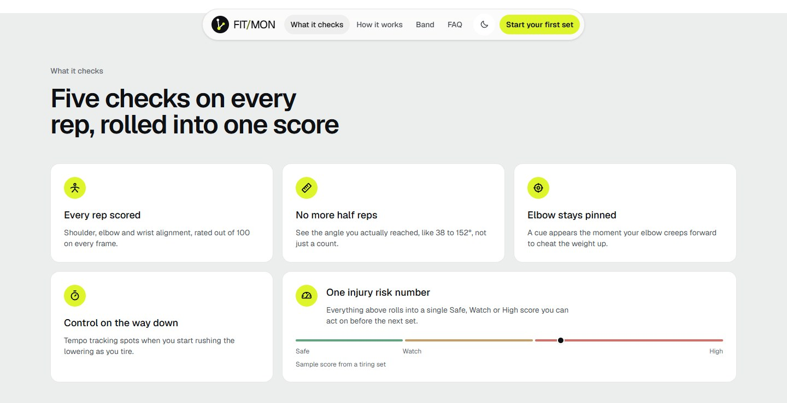
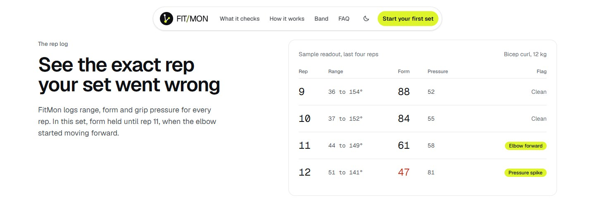
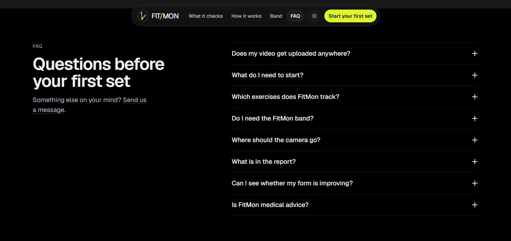
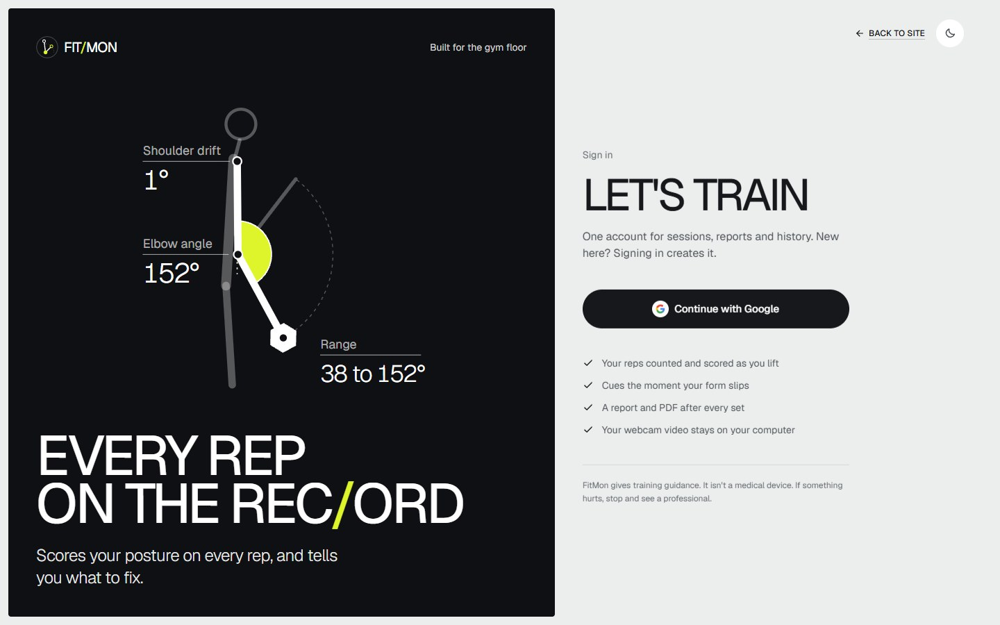

# FitMon

FitMon checks your bicep curl form through a webcam. It counts your reps, scores your posture on each one, and warns you when your elbow starts to drift or you rush the lowering phase. When you finish a set you get a short report with a grade, a rep-by-rep chart and a PDF you can download.

You can also wear an optional wrist band with a force sensor (FSR). If it's connected, FitMon adds grip pressure to the score so it can tell a heavy rep apart from a sloppy one.

## Screenshots

### Homepage



The first screen is a full-width photo with the pitch on top and a single button, **Start your first set**, which takes you to Google sign-in. The two lines under the button answer the usual first worries: your video stays on your computer, and there's nothing to install.



On a phone the text moves to the bottom of the photo and the tint gets darker so it stays readable. The headline, the button and both reassurances all fit on the first screen.

### Form in motion



The 3D model shows what FitMon measures from the side: the elbow angle, how far the shoulder drifts, and the range of the curl. The tracked shoulder, elbow and wrist are marked in volt, the same three points the camera follows in a real session. It loops through a full curl, and you can drag it to turn it around. This shot is in dark mode; every page has a light and a dark theme, switched from the button in the navigation.

### What it checks



The checks FitMon runs on every rep: posture, range of motion, elbow drift and tempo. They roll up into one injury risk score on a Safe, Watch, High scale.

### The rep log



A sample of the per-rep readout. Form drops from 88 to 47 over the last four reps of a tiring set, and the reps where the elbow moved forward or grip pressure spiked are flagged. Your own reports break every set down rep by rep in the same way.

### FAQ



Answers to the questions people ask before trying it, such as where the video goes, what you need to start and whether you need the band.

### Sign in



Sign-in uses your Google account. The first sign-in creates your FitMon account; after that you land on your dashboard.

## How it works

1. The browser runs MediaPipe pose detection on your webcam feed. The video itself never leaves your computer.
2. For each frame it works out the elbow angle, stability and smoothness, and counts reps.
3. Those numbers, plus the detected body points, are sent to the backend over Socket.IO. If the band is on, its pressure readings come in over HTTP and get merged with the camera data.
4. When you end the session, the backend builds the report, optionally asks Gemini for coaching notes, and saves it to Firestore.

## What's in the repo

```
backend/    Node.js + Express + Socket.IO server (sessions, sensor data, reports, Firestore)
frontend/   React + Vite + Tailwind web app (landing page, live session, reports, history)
IOT/        Arduino sketch for the ESP8266 wrist band
```

## Before you start

You need:

- Node.js 20.19 or newer (22 LTS is a safe choice)
- A Firebase project with Google sign-in and Firestore turned on
- A webcam
- Optional: a Gemini API key from Google AI Studio, for the coaching notes in reports
- Optional: an ESP8266 board with an FSR on pin A0, for the band

## Quick start on Windows

If you just want to run it:

1. Install Node.js LTS from https://nodejs.org.
2. Unzip or clone the project and double-click `start-windows.bat`.
3. The first time, it creates `backend\.env` and `frontend\.env` and opens them in Notepad. Fill them in (see [Setup](#setup) below for where each value comes from), save, and double-click `start-windows.bat` again.
4. It installs the packages, starts the backend and the website in two windows, and opens http://localhost:5173.

Close the two windows to stop it.

## Setup

Clone the repo and open two terminals, one for the backend and one for the frontend.

### Backend

```
cd backend
npm install
cp .env.example .env
```

On Windows use `copy .env.example .env` instead of `cp`.

Open `backend/.env` and fill it in. The Firebase admin key comes from the Firebase console: Project settings, then Service accounts, then "Generate new private key". Save the file as `backend/serviceAccountKey.json`. The `.gitignore` already keeps it out of git.

Then start the server:

```
npm run dev
```

It runs on http://localhost:3001. You can check it's up at http://localhost:3001/api/health.

### Frontend

```
cd frontend
npm install
cp .env.example .env
```

Fill in the six `VITE_FIREBASE_*` values in `frontend/.env`. You'll find them in the Firebase console under Project settings, General, Your apps (pick or add a web app).

```
npm run dev
```

Open http://localhost:5173.

### Firebase settings

In the Firebase console:

- Authentication, Sign-in method: turn on Google. `localhost` is already an authorized domain.
- Firestore Database: create a database. FitMon writes to the `users`, `sessions` and `contactMessages` collections.

## Environment variables

### backend/.env

| Variable | Required | What it's for |
|---|---|---|
| `PORT` | no | Server port. Defaults to 3001. |
| `CLIENT_ORIGINS` | no | Comma-separated list of allowed frontend URLs. Defaults to `http://localhost:5173,http://localhost:3000`. |
| `FIREBASE_SERVICE_ACCOUNT_PATH` | yes* | Path to the service account JSON, e.g. `./serviceAccountKey.json`. |
| `FIREBASE_PROJECT_ID`, `FIREBASE_CLIENT_EMAIL`, `FIREBASE_PRIVATE_KEY` | yes* | Use these three instead of the file path if you'd rather not keep a JSON file (handy on hosting platforms). |
| `GEMINI_API_KEY` | no | Turns on the AI coaching notes in reports. |
| `GEMINI_MODEL` | no | Defaults to `gemini-2.0-flash`. |
| `SENSOR_API_KEY` | no | Shared key the band sends in the `x-api-key` header. Defaults to `changeme123`; change it. |
| `FSR_MIN`, `FSR_MAX` | no | Raw sensor range used to scale pressure. Defaults to 0 and 1023. |

\* Use either the file path or the three separate values. The server won't start without one of them.

### frontend/.env

| Variable | Required | What it's for |
|---|---|---|
| `VITE_FIREBASE_API_KEY` | yes | From your Firebase web app config. |
| `VITE_FIREBASE_AUTH_DOMAIN` | yes | Same. |
| `VITE_FIREBASE_PROJECT_ID` | yes | Same. |
| `VITE_FIREBASE_STORAGE_BUCKET` | yes | Same. |
| `VITE_FIREBASE_MESSAGING_SENDER_ID` | yes | Same. |
| `VITE_FIREBASE_APP_ID` | yes | Same. |
| `VITE_API_URL` | no | Backend URL. Defaults to `http://localhost:3001`. |
| `VITE_SOCKET_URL` | no | Socket.IO URL. Defaults to `http://localhost:3001`. |

## Setting up the band (optional)

1. Open `IOT/iot.cpp` in the Arduino IDE with the ESP8266 board package installed.
2. Change `WIFI_SSID`, `WIFI_PASSWORD`, `SERVER_IP` (the LAN IP of the computer running the backend) and `API_KEY` (must match `SENSOR_API_KEY`).
3. Upload it. The board reads the FSR on A0 once a second and posts it to `/api/iot/reading`.

Your computer and the board need to be on the same Wi-Fi network.

## Using it

1. Sign in with Google.
2. Go to Session and allow camera access.
3. Stand side-on to the camera with your working arm fully in frame.
4. Press Start session and do your set. Cues show up on the right if your form slips.
5. Press End session. The report opens on its own, and you can download it as a PDF.
6. History lists all your past sessions, and Profile shows your streak and accuracy. Use **Edit profile** there to change your name, your training goal and which arm live sessions track.

Only one app can use the webcam at a time, so close video calls and other camera apps first.

## API overview

HTTP:

| Method | Path | Notes |
|---|---|---|
| GET | `/api/health` | Health check |
| POST | `/api/auth/session` | Exchanges a Firebase ID token for the app user (needs `Authorization: Bearer <token>`) |
| GET | `/api/auth/me` | Same, for an existing login |
| PATCH | `/api/profile` | Updates `name`, `goal` and `trackedArm` (`auto`, `left` or `right`) for the signed-in user |
| POST | `/api/iot/reading` | Band reading, body `{ "value": 512 }`, header `x-api-key` |
| POST | `/api/contact` | Contact form on the landing page |

Socket.IO events, client to server: `start_session`, `cv_results`, `iot_data`, `end_session`.
Server to client: `session_started`, `feedback`, `session_summary`.

## Scripts

| Folder | Command | Does |
|---|---|---|
| backend | `npm run dev` | Starts the server with auto-reload (nodemon) |
| backend | `npm start` | Starts the server without auto-reload |
| frontend | `npm run dev` | Starts the dev server |
| frontend | `npm run build` | Builds the site into `frontend/dist` |
| frontend | `npm run preview` | Serves the built site locally |
| frontend | `npm run lint` | Runs ESLint |

## Troubleshooting

**"running scripts is disabled on this system" on Windows.** PowerShell is blocking npm. Run `Set-ExecutionPolicy -Scope CurrentUser -ExecutionPolicy RemoteSigned`, then open a new terminal. Or type `npm.cmd` instead of `npm`.

**"'nodemon' is not recognized".** You haven't run `npm install` in the `backend` folder yet.

**"Firebase Admin credentials are missing".** `backend/.env` is missing or doesn't point to your service account key.

**"Sign-in is not available right now".** The `VITE_FIREBASE_*` values in `frontend/.env` are missing. Restart `npm run dev` after editing `.env`.

**"Can't reach the session server" on the Session page.** The backend isn't running, or `VITE_SOCKET_URL` points somewhere else.

**"Camera unavailable".** Another app is using the webcam, or the browser was denied permission. Check the camera icon in the address bar.

## Notes

- FitMon gives training guidance. It isn't a medical device.
- Right now it only tracks bicep curls.
- The design notes for the current UI are in `frontend/docs/UI_REDESIGN.md`.
